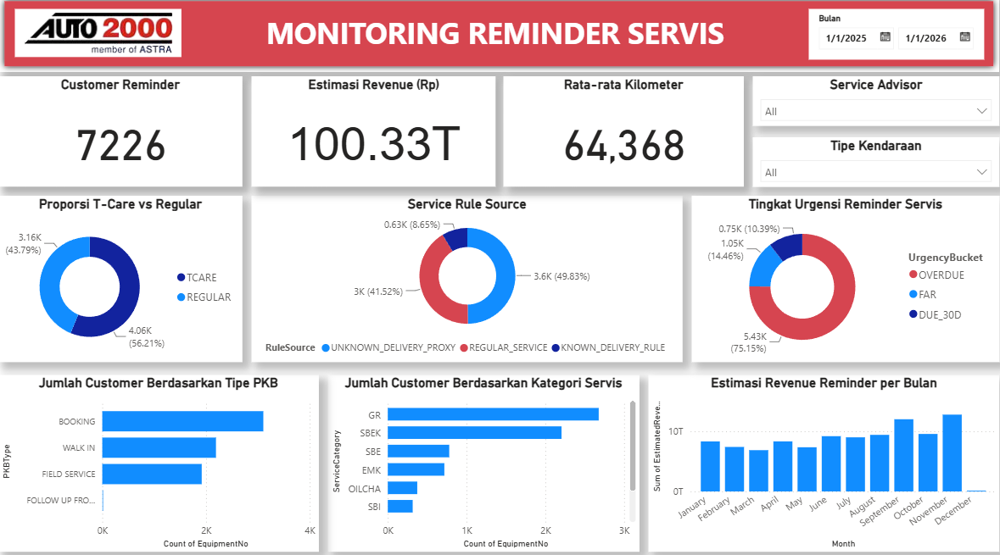

# Service Reminder Analytics

Operational analytics project developed during my **Business Data Analyst internship at Auto2000 Kenjeran** to support recurring automotive aftersales service reminders.

The project combines **historical service data, business-rule scheduling, machine-learning risk scoring, automated reminder targeting, Google Sheets integration, and Power BI monitoring** into a repeatable monthly workflow.

## Project Overview

The workflow was designed to simplify recurring service-reminder operations by integrating historical service records from multiple data sources and transforming them into a prioritized reminder list.

The pipeline processes historical **PKB** and **SO** data, determines service eligibility using operational rules, calculates the next reminder schedule, and applies an **XGBoost model** to generate customer risk scores.

The resulting customer list is then exported to Google Sheets and visualized through an interactive Power BI dashboard.

## Workflow

```text
Historical PKB & SO Data
        ↓
Data Cleaning & Integration
        ↓
Service Eligibility Rules
        ↓
Reminder Scheduling
        ↓
XGBoost Risk Scoring
        ↓
Reminder Target Generation
        ↓
Google Sheets Output
        ↓
Power BI Monitoring
```

## Business Rules

The operational reminder process combines different service-rule sources, including:

- T-Care service scheduling
- Regular service scheduling
- Known delivery-date rules
- Proxy rules for customers without complete delivery information

The rule-based component determines **when a customer should be reminded**, while the machine-learning model provides a **risk score used to support prioritization**.

## Machine Learning

An existing **XGBoost pipeline** is used to calculate customer-level risk scores.

The model consumes a predefined set of features and generates a probability score that is incorporated into the final reminder-target dataset.

In this project, machine learning does not replace service scheduling rules. Instead, it complements operational rules by helping prioritize customers within the reminder workflow.

## Automated Output

The pipeline generates two primary outputs:

### All Customer

Contains the processed operational customer list, including:

- customer information
- vehicle information
- service history
- next reminder schedule
- reminder rule source
- risk score
- urgency information
- estimated revenue

### Reminder Target

Contains customers selected for the operational reminder period.

The pipeline also creates structured WhatsApp reminder links so that the resulting list can support follow-up activities.

## Power BI Dashboard

The Power BI dashboard provides monitoring across:

- total reminder customers
- estimated reminder revenue
- average vehicle mileage
- T-Care vs regular service proportion
- service rule source
- reminder urgency
- customer distribution by PKB type
- customer distribution by service category
- monthly estimated reminder revenue



## Dashboard Highlights

The dashboard is designed to help operational teams quickly monitor:

- reminder workload;
- potential revenue associated with reminder targets;
- service composition;
- urgency of upcoming service reminders;
- customer segmentation across service types;
- monthly revenue trends.

## Monthly Operational Process

The workflow is designed to support recurring updates.

For each operational period:

1. Upload the latest PKB and SO files.
2. Set the target reminder month.
3. Run the notebook pipeline.
4. Update the Google Sheets output.
5. Refresh the Power BI dashboard.

This structure reduces the amount of repetitive manual processing required for monthly reminder monitoring.

## Tools & Technologies

- Python
- Pandas
- NumPy
- Scikit-learn
- XGBoost
- Joblib
- Google Colab
- Google Sheets
- Gspread
- Power BI

## Repository Contents

```text
service-reminder-analytics/
├── README.md
├── service_reminder_pipeline_public.ipynb
├── requirements.txt
└── images/
    └── service_reminder_dashboard.png
```

## Notes

This repository contains a **portfolio-safe version** of the original internship project.

Customer-level records, phone numbers, internal Google Drive paths, spreadsheet URLs, trained model artifacts, branch contact details, credentials, and proprietary source files are intentionally excluded from the public repository.
