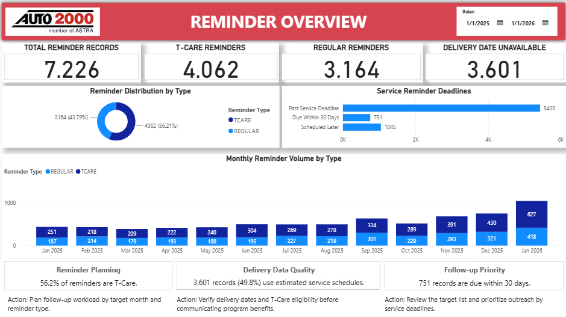
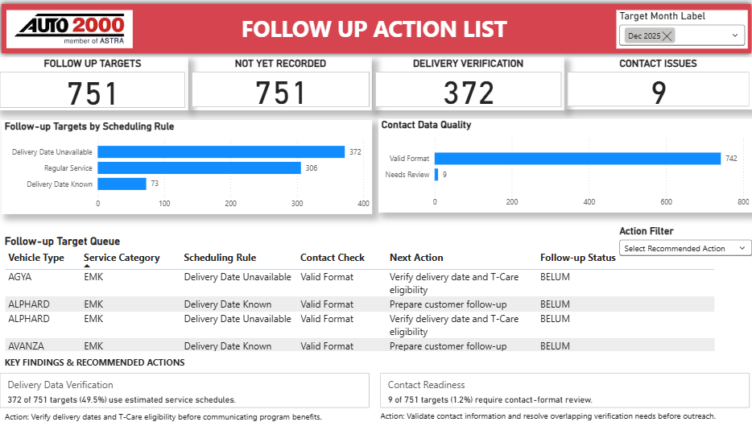

# Service Reminder Analytics — Auto2000 Kenjeran

**Business Data Analyst Internship Project | Automotive Aftersales | Python · XGBoost · Google Sheets · Power BI**

An operational analytics prototype developed during my Business Data Analyst internship at Auto2000 Kenjeran to support **service-reminder scheduling, data-quality checks, and follow-up prioritization**. The project combines historical service and sales-order data, operational scheduling rules, machine-learning scoring, and interactive dashboards to turn service records into a reviewable follow-up workflow.

> **Project status:** Presented and tested during the internship. Continued operational adoption after the internship has not been verified. The dashboard figures below describe test outputs, not measured improvements in customer retention or staff productivity.

## 1. Business Context and Problem

At Auto2000 Kenjeran, the aftersales reminder process involves identifying customers approaching a scheduled service, checking their service history, and coordinating follow-up through the **Maintenance Reminder & Appointment (MRA)** and **Customer Relation Coordinator (CRC)** teams, with oversight from the Service Head.

The initial internship briefing identified several operational challenges:

- **Manual follow-up workload:** Service reminders involved telephone calls, making recurring outreach time-consuming for the team.
- **Branch-level visibility:** An existing centralized reminder process did not fully address the branch's specific need to inspect and prioritize its own target list.
- **Disconnected operational records:** Workshop service transactions (**PKB**) and vehicle sales-order records (**SO**) had to be reconciled to apply appropriate scheduling rules.
- **Incomplete information:** Missing vehicle delivery dates and problematic contact formats could make reminders less reliable if they were not flagged for review.

**Business question:** How can historical service and sales-order data be transformed into a repeatable, reviewable reminder workflow that helps staff determine **which records need attention, why they need attention, and what to check before contacting customers**?

The project addresses **reminder preparation and operational visibility**, not automatic proof that a customer is due, eligible for a free service, or has failed to return.

## 2. Data Sources and Analytical Scope

The workflow uses two types of authorized historical operational data. The raw source files are not included in this public repository.

| Data source | Relevant information | Role in the analysis |
|---|---|---|
| **PKB — Workshop service records** | Service dates, vehicle identifiers, service categories, mileage, and other operational attributes | Reconstruct service history, identify the latest eligible service record, and calculate candidate next-service schedules |
| **SO — Sales-order records** | Vehicle purchase/delivery information when available, linked by vehicle identifier | Provide a delivery-date reference for T-Care scheduling and distinguish known delivery dates from missing information |
| **Derived pipeline outputs** | Rule source, reminder type, estimated target date, urgency, contact-format checks, optional model score | Support Power BI aggregation, monthly target extraction, and recommended next-action grouping |

**Analytical units matter:** Dashboard figures refer to **generated reminder records or target records**, not automatically unique customers. The **7,226** records visible in Reminder Overview are a cross-period dashboard selection; the **751** records in Follow-up Action List are a **December 2025 test extract**. These are not the original row counts of the PKB and SO input datasets.

**Missing delivery-date assumption:** When a T-Care-related record lacks an available delivery date, the pipeline uses a **six-month interval from the latest recorded service date as a scheduling proxy**. This is a project-level fallback assumption, **not an official confirmation of service entitlement**. The output flags such cases for delivery-date and T-Care eligibility verification before any program benefit is communicated.

## 3. Project Objectives

1. Integrate and clean historical PKB and SO records for reminder analysis.
2. Apply rule-based scheduling for T-Care and regular service, including explicitly identified delivery-date proxies where information is unavailable.
3. Incorporate an existing XGBoost-based scoring component as supplementary customer-level model output; service dates are determined by scheduling rules, not by the model.
4. Produce a month-specific reminder-target extract and support review through Google Sheets and Power BI.
5. Identify targets requiring **contact verification**, **delivery/T-Care eligibility verification**, or **follow-up preparation**.

## 4. Analytical Workflow

```text
Historical PKB + SO Records
           |
           v
Data Cleaning and Integration
           |
           v
T-Care / Regular Service Scheduling Rules
           |
           v
Next Reminder Dates + Rule Source + Urgency
           |
           v
Supplementary XGBoost Scoring
           |
           v
All Customer Overview + Month-Specific Reminder Target
           |
           v
Google Sheets Output / Power BI Dashboard
           |
           v
Data-Quality Review + Recommended Next Actions
```

**Rule-based logic** determines reminder scheduling and identifies whether a known delivery date or a six-month fallback proxy from the latest service was used. **Model scoring** is a separate analytical component; the dashboard's recommended actions are based on operational checks rather than an assertion that the model alone determines the follow-up decision.

The notebook uses a configured target month for the operational extract. Rerunning it for a different month requires appropriate input data and execution settings; the current repository is not evidence of an unattended production scheduler.

## 5. Power BI Dashboard

### Page 1 — Reminder Overview



The overview provides a cross-period view of generated reminder records, service type, deadline categories, and monthly scheduling volume.

| Metric | Dashboard result |
|---|---:|
| Total reminder records | 7,226 |
| T-Care reminder records | 4,062 (56.2%) |
| Regular reminder records | 3,164 (43.8%) |
| Records without a delivery date | 3,601 (49.8%) |
| Past scheduled service deadline | 5,430 |
| Due within 30 days | 751 |
| Scheduled later | 1,045 |

**Interpretation:** The dashboard helps review scheduling volume and potential verification workload. Deadline categories are calculated relative to the pipeline's reference date; a past deadline does **not** establish that a customer failed to return for service. Counts refer to **reminder records**, not necessarily distinct customers.

### Page 2 — Follow-up Action List



The month-specific **December 2025 test snapshot** contains 751 target records. It provides scheduling-rule and contact-format breakdowns, an interactive action filter, a target-category preview, and recommended next steps.

| Metric | December 2025 snapshot |
|---|---:|
| Follow-up target records | 751 |
| Follow-up not recorded in the test output | 751 |
| Targets using a delivery-date proxy | 372 (49.5%) |
| Targets requiring contact-format review | 9 (1.2%) |
| Targets with a valid phone-number format | 742 (98.8%) |

**Scheduling-rule distribution:** 372 delivery-date unavailable, 306 regular service, and 73 delivery-date known.

**Important:** `BELUM` means no follow-up was recorded in this test output, not that these customers were definitely never contacted. A valid phone-number format does not establish that the number is active or reachable.

## 6. Business Findings and Recommended Actions

### Finding 1 — Missing delivery information creates a verification workload

**372 of 751 targets (49.5%)** use estimated scheduling because a delivery date was not available in the processed data.

**Action:** Verify delivery information and T-Care eligibility before communicating complimentary-service benefits. Estimated dates must not be presented as confirmed eligibility.

### Finding 2 — Contact and delivery checks can overlap

**9 of 751 targets (1.2%)** require contact-format review. Among those nine, **three** also use an estimated delivery schedule.

**Action:** Check contact information and delivery eligibility independently. Completing one check does not automatically resolve the other.

### Finding 3 — Translate data checks into an actionable queue

A rule-based **first-action** classification produced the following mutually exclusive groups in the December 2025 test snapshot:

| First recommended action | Target records | Share |
|---|---:|---:|
| Prepare customer follow-up | 373 | 49.7% |
| Verify delivery date and T-Care eligibility | 369 | 49.1% |
| Verify contact details | 9 | 1.2% |
| **Total** | **751** | **100%** |

The **372** records requiring delivery verification include the three records assigned to **contact verification first**. Therefore, 369 is the *delivery-first* queue, whereas 372 is the *total delivery-verification need*. In all, **378 records (50.3%)** are assigned a verification task before follow-up preparation by the rule-based first-action logic.

**Operational interpretation:** This queue provides an explicit review order for MRA/CRC. The recommended action identifies a **first step**, not the full set of checks that may eventually be required, and it does not indicate that outreach has already occurred.

## 7. Recommended Operational Actions and Next Improvements

### Immediate actions suggested by the test snapshot

| Finding from the snapshot | What MRA/CRC should review | What successful handling would look like |
|---|---|---|
| **372 records** use a delivery-date proxy | Confirm the actual delivery date and T-Care service eligibility before mentioning complimentary benefits | Delivery information and eligibility recorded as verified or flagged for manual resolution |
| **9 records** require phone-format review | Correct/confirm contact details through authorized processes before outreach | A usable, approved contact record or a documented exception |
| **3 records** occur in *both* groups | Complete **both** contact and eligibility checks; the first-action label alone is not a complete checklist | Both issues separately resolved or appropriately escalated |
| **373 records** enter follow-up preparation first | Review the proposed schedule and appropriate messaging; follow permitted outreach procedures | A reviewed target and a properly logged follow-up outcome |

These are **proposed actions based on the prototype output**, not claims that Auto2000 performed them or that service bookings increased.

### Potential next improvements — not yet validated

1. **Capture actual follow-up outcomes.** Introduce consistent statuses such as attempted contact, reached, booking created, completed service, and reason not reached. Preserve timestamps and staff attribution where authorized.
2. **Measure the operational funnel.** Track contact-attempt rate, contact-success rate, booking conversion, and completed-service rate, with clearly defined denominators and a consistent observation window.
3. **Assess workflow efficiency.** Compare staff time spent preparing lists and logging reminders before versus after using the workflow; avoid attributing time savings without a measured baseline.
4. **Monitor data quality.** Track the share of records missing delivery dates, the share of contact-format exceptions, resolution rates, and how many targets require more than one verification step.
5. **Validate scheduling and model usefulness.** Compare estimated next-service dates against subsequently verified service information, and assess whether model scores contribute useful prioritization beyond business-rule baselines before relying on them operationally.
6. **Review privacy and operational safeguards.** Validate eligibility against authorized sources and use approved customer-contact channels and consent/privacy processes before any live messaging.

**Success criteria are proposed, not achieved results.** No baseline-to-follow-up comparison or causal uplift evaluation was completed as part of the documented test.

## 8. Operational Outputs and Review Workflow

The pipeline produces two analytical outputs:

- **All Customer:** A processed overview of service/reminder records, rule sources, scheduling information, and supporting analytical fields.
- **Reminder Target:** A period-specific target extract for follow-up review, including contact-check and scheduling-rule information.

The intended manually triggered refresh process is:

1. Prepare authorized, updated PKB and SO source files.
2. Configure the target period and run the pipeline.
3. Review generated targets and data-quality exceptions.
4. Update the relevant Google Sheets output.
5. Refresh the Power BI dataset and inspect the dashboard.

The pipeline may generate structured WhatsApp reminder links/templates for authorized review. **This repository does not demonstrate automatic message delivery or verified customer outreach.**

## 9. Tools and Techniques

**Python, Pandas, NumPy, scikit-learn, XGBoost, Joblib, Google Colab, Google Sheets / gspread, Power BI.**

Techniques include data cleaning and integration, business-rule implementation, date-based scheduling, data-quality checks, supplementary model scoring, and KPI/dashboard design.

## 10. Repository Contents

```text
service-reminder-analytics/
├── README.md
├── service_reminder_pipeline_public.ipynb
├── requirements.txt
└── images/
    ├── service_reminder_dashboard.png  # Earlier dashboard image (optional/archive)
    ├── reminder_overview.png
    └── followup_action_list.png
```

The two new image references above will work **after** the corresponding screenshots are uploaded to `images/` using those exact filenames.

## 11. Scope, Privacy, and Limitations

- **Internship prototype:** The workflow was presented and tested during the internship; continued adoption or production deployment is unconfirmed.
- **No validated business uplift:** Changes in retention, bookings, staff workload, or outreach conversion were not measured as outcomes of this prototype.
- **Delivery-date proxy:** A six-month interval from the latest recorded service is used when the delivery date is missing. This is an analytical scheduling assumption, not a verified vehicle-delivery date or guaranteed T-Care entitlement.
- **Model scoring:** Supplementary XGBoost scores do not replace official service rules or validation of customer eligibility.
- **Data quality:** A valid-format phone number may still be unreachable; output statuses are not independently verified CRM activity logs.
- **Sensitive information:** Customer-level records, phone numbers, vehicle identifiers, internal spreadsheets, credentials, trained artifacts, and proprietary source files are not intended for publication. Do not upload the original `.pbix` or source Excel files unless their embedded data has been independently sanitized and disclosure is authorized.

*Portfolio documentation reflects an internship test case and emphasizes operational reasoning, transparent assumptions, and action-oriented reporting.*
